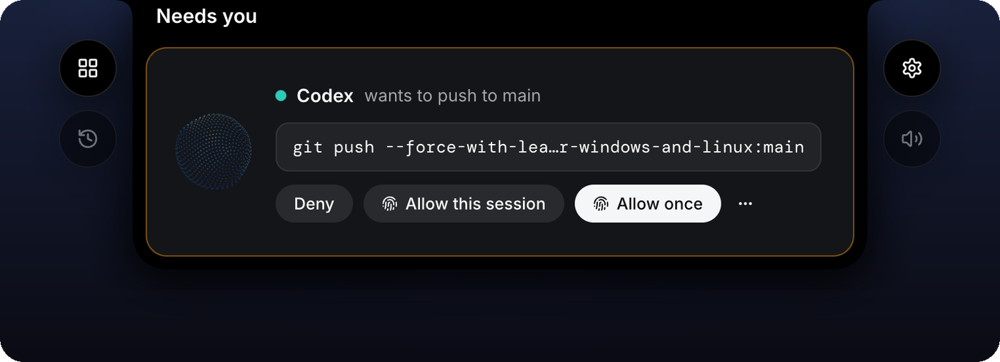
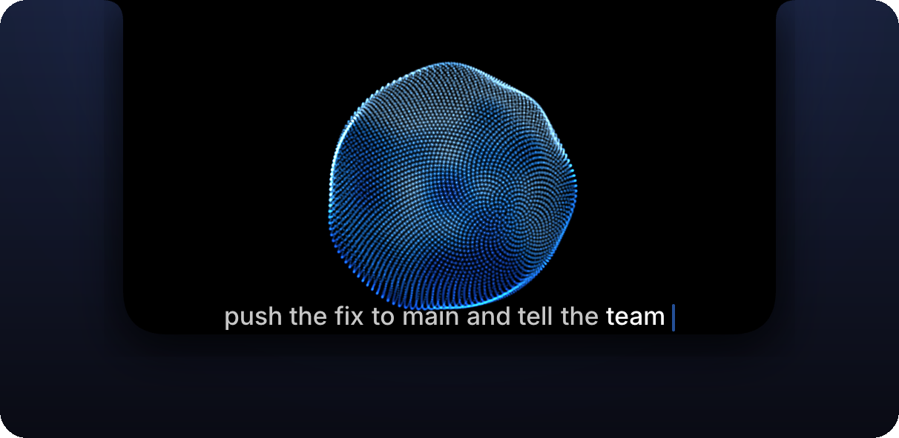
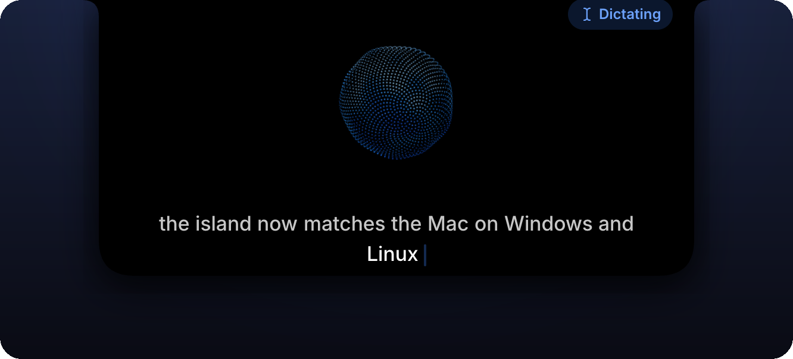
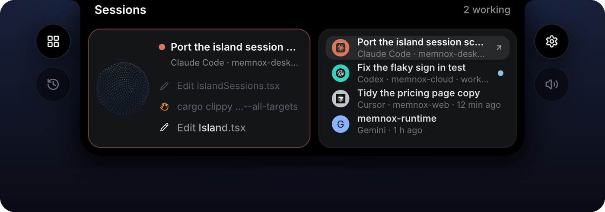
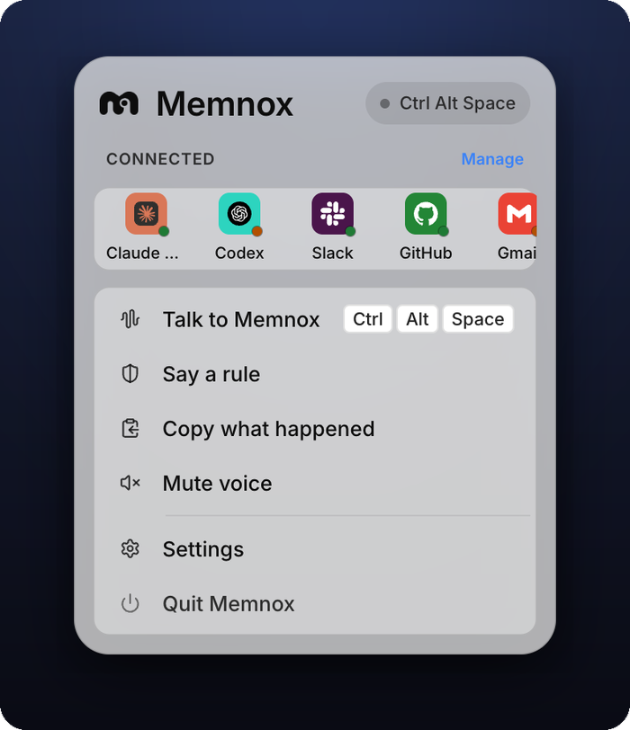

<div align="center">

<picture>
  <source media="(prefers-color-scheme: dark)" srcset="macos/Support/Logo/memnox-mark-white.png">
  
</picture>

# Memnox for the desktop

### Talk to your coding agents. Answer them from the top of your screen, and sign every yes.

[](macos)
[](windows)
[](linux)
[](shared)
[](LICENSE)

[Platforms](#platforms) · [Features](#features) · [Screens](#the-windows-and-linux-app) · [Build and test](#build-and-test) · [How Windows and Linux differ](#how-windows-and-linux-differ-from-the-mac) · [Docs](#docs)

<br>



<sub>A held call on Windows and Linux: the same island, the same three answers and the same signed yes as on the Mac.</sub>

</div>

---

Memnox desktop is the face, the voice and the signing key of [Memnox](VISION.md) on macOS, Windows
and Linux. The daemon in [memnox-runtime](https://github.com/Memnox/memnox-runtime) decides what an agent may
do; these apps show what waits on you in an island at the top of the screen, speak and listen, and
sign every yes that reaches outside a session with a key the operating system guards.

## Platforms

| | Install | Built with | Status |
|---|---|---|---|
| **macOS**<br><sub>14 or later, Apple silicon</sub> | the one line below, which runs [`macos/scripts/install.sh`](macos/scripts/install.sh) | Swift 6 on Apple frameworks, in [`macos/`](macos) | developer preview |
| **Windows**<br><sub>10 and 11, x64</sub> | [memnox.com/download/windows](https://memnox.com/download/windows), the installer from the [latest release](https://github.com/Memnox/memnox-desktop/releases/latest) | Tauri, React and Rust, in [`shared/`](shared) with [`windows/`](windows) | preview, built and tested in CI |
| **Linux**<br><sub>x86_64</sub> | the same line, which runs [`linux/scripts/install.sh`](linux/scripts/install.sh): deb, rpm or AppImage | the same Tauri app, with [`linux/`](linux) | preview, built and tested in CI |

```sh
# macOS or Linux: on Linux, the deb where apt is, the rpm where dnf or zypper is, the AppImage anywhere else
curl -fsSL https://memnox.com/install | sh
```

On Windows, download [memnox.com/download/windows](https://memnox.com/download/windows) and open it.
The preview is not signed yet, so SmartScreen asks first: choose **More info**, then **Run anyway**.

Each installer checks its download against the checksum published with the release before it
installs anything. Arch users can build the PKGBUILD published beside the Linux packages. The phone
apps live in [memnox-mobile](https://github.com/Memnox/memnox-mobile).

## Features

The same on every desktop:

- **The island.** It hangs from the top of the screen and grows to the size of what it has to say.
- **Held calls.** Deny, Allow this session or Allow once, and every allow is signed.
- **The voice.** Talk key, wake word, talking over it, chimes, and Kokoro speaking on your computer.
- **Dictation.** Hold a key and it types where your cursor is, in any app, never in a password field.
- **Say a rule.** Hold a key, say it, and the rule goes in force only with a signature.
- **Sessions.** Every agent's session with its latest steps, a live window, a history and a switcher.
- **Connected tools.** Any app you use, added from the Tools panel or by saying "connect my Notion" and signed in as you, on every plan. A draft you read comes before Send.
- **Phones and servers.** Pair a phone, reach a server over the end to end encrypted relay.
- **Team calls.** Sign in, and calls from your team's inbox arrive on the island, answered signed.
- **Settings and a first run.** Every page the Mac has, in light and dark, with a guided setup that
  installs the runtime and the voice itself.

## The Windows and Linux app

<table>
<tr>
<td width="50%" valign="top">

<p><b>The voice.</b> Press Ctrl Alt Space or say "Memnox", and what you say goes whole to your own agent.</p>
</td>
<td width="50%" valign="top">

<p><b>Dictation.</b> Hold right Alt, or right Ctrl where right Alt is AltGr, and it types where your cursor is.</p>
</td>
</tr>
<tr>
<td colspan="2" valign="top">

<p><b>Sessions.</b> Every agent's session with its latest steps, one press from its own terminal or editor.</p>
</td>
</tr>
<tr>
<td width="62%" valign="top">
<picture>
  <source media="(prefers-color-scheme: dark)" srcset="docs/images/tauri-settings-dark.png">
  
</picture>
<p><b>Settings</b>, in light or dark to match your system, with the same pages as the Mac's.</p>
</td>
<td width="38%" valign="top">
<picture>
  <source media="(prefers-color-scheme: dark)" srcset="docs/images/tauri-tray-panel-dark.png">
  
</picture>
<p><b>The tray panel</b> opens beside the icon on a left click, on glass where the system offers it.</p>
</td>
</tr>
</table>

The Mac app has its own pictures in [`macos/README.md`](macos/README.md).

## Build and test

Each app expects a [memnox-runtime](https://github.com/Memnox/memnox-runtime) checkout beside this repo,
named `memnox-runtime`, or one named by `MEMNOX_RUNTIME`.

<details>
<summary><b>macOS</b>: Xcode 26 or later on macOS 14 or later</summary>

```sh
cd macos
scripts/signing-setup.sh   # once, so macOS remembers the app's permissions between builds
scripts/vendor-noise.sh    # once, the Noise framework from the runtime checkout
swift test                 # the headless core, in about a second
./scripts/bundle.sh        # builds ../memnox-runtime, then build/Memnox.app against it
open build/Memnox.app
```

[`macos/README.md`](macos/README.md) has the npm and disk image builds, the voice, and how the app
is put together.

</details>

<details>
<summary><b>Windows and Linux</b>: Node 22, pnpm 9.15.4 and stable Rust</summary>

On Linux, first install the libraries [`linux/README.md`](linux/README.md#build-from-source) lists.
On Windows, run the `pnpm wire` step from Git Bash, since it is a shell script.

```sh
cd shared/tauri-core
pnpm wire                 # builds memnox-runtime's core and copies its wire into .runtime
pnpm install
pnpm typecheck && pnpm test
cargo test --workspace    # the key, the DER conversion, the Noise vectors, the daemon link, the voice
pnpm tauri dev            # the app itself
```

`pnpm tauri dev` also starts on a Mac, where it has no key and signs nothing but shows its windows
and talks. Quit the Mac app first, since both would answer the same daemon.

</details>

<details>
<summary><b>Every screen in a browser</b>, with no Tauri and no daemon</summary>

```sh
cd shared/tauri-core && pnpm dev
```

Then open `http://localhost:1420/preview.html`, which lists every island scene over a scripted
daemon, such as `?mode=held`, `?mode=voice-listening` or `?mode=sessions-overview`. The other pages
preview the same way: `settings.html?theme=dark`, `tray.html?preview=panel`,
`onboarding.html?stage=steps`, `previews/tour.html` and `previews/tools.html`. The screenshots above come from
these pages.

</details>

<details>
<summary><b>On a real machine</b></summary>

[TESTING.md](TESTING.md) walks through trying each app for real: a Windows 11 PC or virtual machine
with Windows Hello, a Linux desktop on GNOME and on KDE, and what has not been proven there yet.

</details>

<details>
<summary><b>CI and releases</b></summary>

[`ci.yml`](.github/workflows/ci.yml) builds and tests the Mac app on macOS 26 and the Tauri app on
Windows and Ubuntu 24.04 (typecheck, vitest, `cargo fmt`, `cargo clippy`, `cargo test` and a debug
build), checks the protocol vectors against the runtime, and refuses a dash in copy.

[`release-app.yml`](.github/workflows/release-app.yml) releases the Windows and Linux app from a tag
`app-v<version>` that matches `shared/tauri-core/src-tauri/tauri.conf.json`. It builds the NSIS and
MSI installers, signed with Azure Trusted Signing once its secrets are set and unsigned until then,
and the AppImage, deb and rpm on Ubuntu 22.04 so older glibc runs them, then publishes them with
SHA256SUMS, the polkit policy, a PKGBUILD and `Memnox-setup.exe`, and marks the release latest. Run by
hand without a tag, it builds the installers as workflow artifacts and publishes nothing.

A release is four steps, because the Mac app is built on a Mac:

1. Raise the version in `shared/tauri-core/src-tauri/tauri.conf.json` and in
   `CFBundleShortVersionString` in `macos/Support/Info.plist`, and commit.
2. Tag `app-v<version>` and push the tag, which builds and publishes the Windows and Linux release.
3. Run `macos/scripts/dmg.sh` on an Apple silicon Mac, which builds `macos/build/Memnox.dmg` with the
   newest `memnox` from npm.
4. Attach it once the release exists:
   `gh release upload app-v<version> macos/build/Memnox.dmg macos/build/Memnox.dmg.sha256`.

Until step 4, memnox.com/download/mac finds no image on the latest release, so do it straight away.
memnox.com/download/windows and memnox.com/download/mac redirect to the latest release by those two
fixed names, which is why every release carries them.

</details>

## Repo layout

```text
memnox-desktop/
├── macos/                the Mac app: a Swift package, its scripts, docs and images
├── shared/
│   ├── tauri-core/       the Windows and Linux app
│   │   ├── src/core/     TypeScript with no DOM and no Tauri: every rule, behind ports
│   │   ├── src/ui/       React and Tailwind: the island, sessions, Settings, the tray panel
│   │   ├── src-tauri/    Rust: the daemon link, keys, typing, focus, the relay, the tray
│   │   ├── crates/       desktop-key, desktop-noise and desktop-voice
│   │   └── test/         the core's tests, run by vitest
│   ├── vectors/          protocol.json from memnox-runtime, which every desktop is tested against
│   └── scripts/          sync-vectors.sh
├── windows/native/       only what Windows does differently
├── linux/                only what Linux does differently: native/, packaging/, scripts/install.sh
├── docs/images/          the screenshots of the Windows and Linux app
├── TESTING.md            trying each app on a real machine
└── Cargo.toml            one Rust workspace for the Tauri app and both platform crates
```

A feature for Windows and Linux is written once in `shared/`; a platform folder holds only what that
operating system does differently.

## How Windows and Linux differ from the Mac

The Windows and Linux app was built to match the Mac screen for screen, from the same states, cards,
buttons and orb shader. These are the places it cannot be the same, each for a reason the system
gives.

| | macOS | Windows | Linux |
|---|---|---|---|
| **Confirm key** | Secure Enclave, Touch ID for each signature | P-256 in the TPM, after Windows Hello | P-256 in the Secret Service, after polkit (fingerprint or password) |
| **Island** | grows out of the notch, or hangs from the top centre | a top centre window that never takes focus | layer shell on KDE, Sway, Hyprland and COSMIC; kept on top on GNOME |
| **Talk key** | Option Space | Ctrl Alt Space | Ctrl Alt Space, through the shortcut portal on Wayland, which asks once |
| **Dictation key** | right Option | right Alt or right Ctrl | right Alt or right Ctrl |
| **Typing for you** | Accessibility | `SendInput`, with UI Automation reading the field | `xdotool` on X11, `wtype` or `ydotool` on Wayland, the RemoteDesktop portal on GNOME |
| **Glass** | system materials | acrylic on Windows 11, solid on Windows 10 | KWin blur on KDE, solid on GNOME |
| **Fonts** | SF Pro and SF Mono | Inter and DM Mono | Inter and DM Mono |
| **Packages** | `Memnox.dmg` | signed NSIS and MSI | AppImage, deb, rpm and PKGBUILD, with SHA256SUMS |

And in behaviour:

- **Bringing a session forward** goes only through each tool's own documented controls. WezTerm,
  and kitty with remote control on, switch to the session's own tab; Windows Terminal can open a new
  tab but not switch to one; VS Code, Cursor and Windsurf come forward through their own command
  line. Memnox never presses keys in another app, closes or interrupts it, or looks at the screen on
  Windows and Linux, so where no control reaches it says so out loud instead.
- **On Wayland** a click outside does not close the island, since no app may watch the pointer
  there, so Escape and the idle close do. On GNOME the island cannot be pinned to a chosen display.
- **The Linux tray** opens the panel on a left click on KDE, and on GNOME with the AppIndicator
  extension; anywhere else it shows the menu.
- **A teammate's proposal answered by voice** asks for Windows Hello or the password twice, where
  the Mac asks once.
- **The keys are weaker.** Neither the TPM key nor the Secret Service key demands the check itself,
  so a process running as you that reaches them directly could sign without it. A paired phone stays
  the stronger place to say yes on Windows and Linux.

## Docs

| Read | For |
|---|---|
| [`macos/README.md`](macos/README.md) | Memnox for macOS: what it does, installing and building it, how it works |
| [`macos/docs/ARCHITECTURE.md`](macos/docs/ARCHITECTURE.md) | the Mac app's layers, ports and adapters, and where new code goes |
| [`shared/README.md`](shared/README.md) | the Windows and Linux app: its core, its UI, its Rust and its crates |
| [`windows/README.md`](windows/README.md) | what Windows does differently, what it needs, and its limits |
| [`linux/README.md`](linux/README.md) | what Linux does on each desktop, its packages, and its limits |
| [`TESTING.md`](TESTING.md) | trying each app on a real machine |
| [`VISION.md`](VISION.md) | the strategy all of Memnox is built toward |

## License

The code is MIT, as [LICENSE](LICENSE) says. The Memnox name and artwork are not, as
[LICENSE-ASSETS.md](LICENSE-ASSETS.md) says. Report a vulnerability as [SECURITY.md](SECURITY.md)
asks, and see the [code of conduct](CODE_OF_CONDUCT.md).
