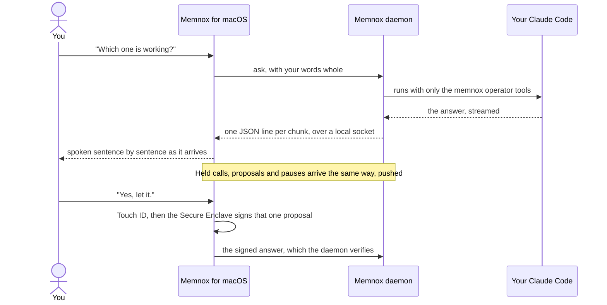
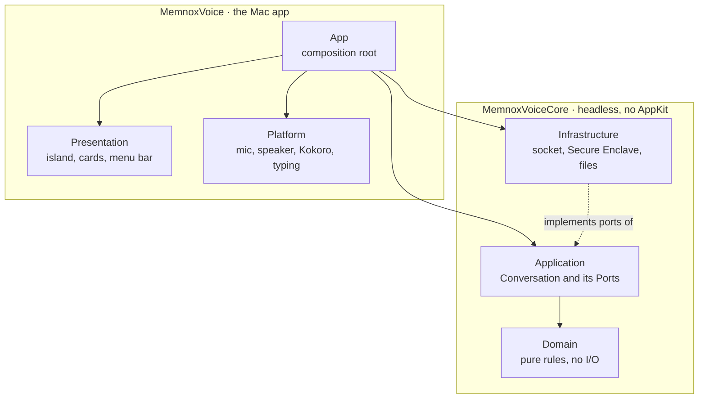

<div align="center">

<picture>
  <source media="(prefers-color-scheme: dark)" srcset="Support/Logo/memnox-mark-white.png">
  
</picture>

# Memnox for macOS

### Talk to your coding agents. Approve with your fingerprint.

An orb that lives in your notch, knows what every agent on your Mac is doing,<br>
tells you out loud, and lets you answer them by voice, with Touch ID guarding every yes.


[Quick start](#quick-start) · [What it does](#what-it-does) · [With your iPhone](#with-your-iphone) · [How it works](#how-it-works) · [Architecture](docs/ARCHITECTURE.md) · [Contributing](#contributing) · [Windows and Linux](../README.md#platforms)

<br>


<sub>One run, one question. The notch asks, the iPhone asks too, and whichever answers first releases the agent.</sub>

</div>

---

> **"Maya, Claude has been on order cancellation in shop for twenty minutes, four files and
> the tests pass. Now it wants to push to main. Should I let it?"**
>
> You say *yes*. Touch ID asks for your finger. The push goes through. You never left your editor.

Your agents already do the work. The hard part is knowing what they are up to and feeling safe
letting them carry on. Memnox for macOS is the face and voice of [Memnox](../VISION.md), the control
plane for autonomous work: it watches Claude Code, Codex, Cursor and the rest through the Memnox
daemon, speaks up only when something needs you, and turns your spoken answer into a signed
decision.

## Why people like it

| | |
|---|---|
| 🎙️ **Just talk** | Your words go whole to your own Claude Code. No keyword matching, no command syntax, no Memnox API key. |
| 🔐 **Touch ID on every yes** | Anything that lets an agent act is signed by a key that never leaves the Secure Enclave. An agent running as you can raise the sheet, and never finish it. |
| 🏝️ **Lives in the notch** | An island grows out of the notch with one dot per working session, their latest steps rolling up, and the code they are changing line by line. |
| 🤫 **Quiet by default** | It says nothing until something needs you: a held call, a question, a paused session, a failure, or what you asked to hear about. |
| 🗣️ **A voice worth hearing** | Kokoro, an open model, runs on your Mac for free. Nothing it says leaves the machine. |
| 🧱 **Built to be read** | Pure Swift on Apple frameworks, a headless core in DDD layers, and a test suite that runs in about a second. |

## The island


The island is the whole interface. It sits closed as the notch until something needs you, then
grows on a spring to the size of what it has to say: the orb and your words while it listens, the
answer while it speaks, every working session with its latest steps, and a held call with its
three answers. It shrinks back the moment it is done. Every agent keeps its own colour, so a dot
tells you who is working before you read a word.

## With your iPhone

<table>
<tr>
<td width="44%" valign="top">

</td>
<td valign="top">

Pair [Memnox for iPhone](https://github.com/Memnox/memnox-mobile/tree/main/ios) once and the Mac stops being the
only place you can answer. The two are the same Memnox: the daemon on this Mac stays the
authority, and the phone is a second face, voice and signing key for it.

- **Pair in a minute.** The Mac shows a QR code, the phone scans it, both screens show the same
  six digits, and you approve on the Mac with Touch ID.
- **The same question, in both places.** A held call opens the island here and the Dynamic
  Island there. Answer on either; the first answer releases the agent and the other settles.
- **Face ID on every remote yes.** Allow on the phone is signed by a key in its own Secure
  Enclave. Deny needs nothing, because saying no can do no harm.
- **Nothing through a push.** The phone updates its own island over an end to end encrypted
  Noise tunnel, so the question never crosses Apple's servers or Memnox's.
- **Call it from anywhere.** Talk to the same orb on the phone while the Mac keeps working, and
  the island here says *Talking on Maya's iPhone* so you know where the voice went.
- **Back at your desk.** When something finishes while you were away, the lock screen says what
  it came to: how long it ran, how many actions, and how often it asked.

</td>
</tr>
</table>

## Slack, Gmail and the rest



Add any app you use from the Tools panel, or say *"connect my Notion"*, and sign in once as
yourself. No admin approves it and no plan counts it. The island can then work in it in your name. Say *"tell #eng the deploy is out and thank Bo"*, or let an agent propose a
reply, and the island opens on a draft in that tool's own colours: the account it goes out as,
who it goes to, and the exact words in a box you can rewrite. Nothing goes out until you press
**Send**, which asks for Touch ID and signs exactly the words on the card. The daemon then sends
it through your own account. The same draft can be answered from your iPhone with Face ID.

## What it does

Things you can say, and what happens:

| You say | It does |
|---|---|
| *"Which one is working?"* | Counts sessions with activity in the last few minutes, never a paused or ended one. |
| *"Open the one fixing checkout."* | Brings forward that session's exact iTerm or Terminal tab, or its editor window. |
| *"Give me a summary of it."* | Puts a glass card in the corner and reads it to you. |
| *"Walk me through it."* | Turns a page per changed file while the voice explains each change. |
| *"Tell Claude Code to commit this in separate commits."* | Reads it back, and after your yes types it into the agent's own prompt. |
| *"Start Claude in memnox cloud on the failing auth test."* | Opens a new tab in that repository and starts a governed session with `memnox run`. |
| *"Have Codex review what Claude just changed."* | Hands Codex your words plus the files Claude changed. |
| *"Tell me when the tests pass."* | Sets a one time watch, and speaks up when it happens. |
| *"That broke the UI, put it back."* | Reads back what goes back, to when, then waits for Touch ID. "Bring it back" undoes the undo. |
| *"Scan my computer."* | Fills the screen with every agent it finds, its MCP servers and its sessions, in a ring. |
| *"Why did that take so long?"* | Draws a waterfall of the turn: hearing you, thinking, each tool, speaking. |
| *"Pause that one."* | Happens at once, because holding an agent back is always safe. *"Resume it"* waits for Touch ID. |

<details>
<summary><b>Everything else it does, in detail</b></summary>

- **Held calls.** When an agent is held, the island opens on it with who is waiting, the command,
  and three answers: Deny, Allow this session and Allow once. Both allows ask for Touch ID, a deny
  needs none, and you can answer the same way by voice in any words.
- **Coming back.** After ten minutes or more with the screen locked, it catches you up on what
  finished, what got stuck and what is waiting, then listens. Turn it off in setup.
- **Talking over it.** Start speaking while it talks and it stops and listens. It tells its own
  echo apart by the words it just said, which works best with headphones.
- **Chimes.** A quiet system sound marks the orb opening and closing, a question sent, an agent
  waiting, an allow taken and a turn that broke, so you hear what happened before it is said.
- **Its name.** Turn on **Wake when I say "Memnox"** and "Memnox, what's going on?" is answered
  straight away. Recognition stays on this Mac, and it is off until you turn it on.
- **Any memnox command.** "Run the doctor" runs at once. "Freeze everything" changes something, so
  it reads it back and waits for Touch ID. A few never run by voice, and it says why.
- **Speak up on its own.** Turn it on in the menu bar panel to also hear when a session finishes,
  commits or pushes.
- **Everywhere else still works.** The terminal, `memnox approve` and the workspace DM keep
  working. Whichever answers first releases the agent.

On a Mac without a notch, the island hangs from the top centre of the screen. To see every state
without any agents running, start it with `open -n build/Memnox.app --args --island-preview`.

</details>

## Quick start

### Developer preview

The quickest way in, on an Apple silicon Mac with macOS 14 or later and one agent such as Claude
Code, Codex or Cursor signed in with its own account:

```sh
curl -fsSL https://raw.githubusercontent.com/Memnox/memnox-desktop/main/macos/scripts/install.sh | sh
```

It downloads the newest release, checks it against the checksum published with it, puts Memnox in
Applications and opens it. The first run asks for its permissions and installs `memnox`, its daemon
and the Kokoro voice, with no Node needed. The preview is signed with the project's own certificate
rather than an Apple Developer ID and is not notarized yet, which is why it installs through
`curl`: a disk image downloaded in a browser is stopped by Gatekeeper, and opens only after
**Open Anyway** under System Settings, Privacy & Security.

The builds released here are the project's own. The code is yours under MIT to read, change and
build; the Memnox name and artwork are not, as [LICENSE-ASSETS.md](../LICENSE-ASSETS.md) says.

### From source

You need macOS 14 or later (26 or later for SpeechAnalyzer) and Xcode 26 or later, and one agent
that talks to a model, such as Claude Code, Codex, Cursor, Hermes or OpenClaw, signed in with its
own account. Memnox has no model of its own and thinks through that agent, so there is no API key
to bring. The app brings
the Memnox runtime itself: on every launch it finds `memnox` or installs it, wires the machine with
`memnox setup --yes` the first time, starts the daemon, and brings a daemon older than the app up
to date. Setup only names a command when one of those steps fails.

Where it gets `memnox` is chosen when it is built, and written into its Info.plist:

- **Local**, the default. `bundle.sh` builds the `memnox-runtime` checkout beside this one (or
  `MEMNOX_RUNTIME_DIR`) with pnpm first, and restarts the daemon on that build when `memnox` on
  your PATH is that checkout. The app runs the checkout: it links it with `npm link` when `memnox`
  is some other copy, and never replaces it with the published package.
- **npm**, for a release: `MEMNOX_RUNTIME_SOURCE=npm ./scripts/bundle.sh`. The app uses a
  `memnox` already installed, installs `memnox@latest` from npm when there is none, and runs
  `memnox update --yes` when the daemon is older than the app.
- **A disk image to download**: `./scripts/dmg.sh` builds `build/Memnox-<version>.dmg`, the npm
  build carrying the newest published runtime with its own Node (`scripts/runtime-pack.sh`) and
  the Kokoro voice pack (`scripts/voice-pack.sh`). On first launch the app unpacks the runtime
  into `~/.memnox/node` with `Support/runtime/unpack.sh`, starts the daemon, and installs the
  voice, all with no Node on the Mac and no connection. A Mac with its own `memnox` keeps using
  it, and `memnox update` updates the one in `~/.memnox/node` in place. It also writes
  `build/Memnox.dmg` and its `.sha256`, the two names a release carries for `scripts/install.sh`.
  Until the image is notarized, a browser download of it needs Open Anyway. Apple silicon only.

```sh
scripts/signing-setup.sh   # once: a local signing identity, so macOS remembers your permissions
scripts/vendor-noise.sh    # once: the Noise framework from the runtime checkout, which git never holds
swift test                 # the core, headless, in about a second
./scripts/bundle.sh        # builds ../memnox-runtime, then build/Memnox.app against it
open build/Memnox.app
```

The first run opens setup: what to call you, permission to hear you, whether the daemon is
running, your Touch ID key, and a voice to try. After that, press **⌥Space** or click the waveform
in the menu bar, and speak.

## How it works



The app is a face, a voice and a Touch ID button. The daemon decides what is allowed and your own
agent does the thinking, so no policy, rule or model call lives here. Speech is recognised by
Apple's SpeechAnalyzer on this Mac (the older recognizer before macOS 26), and answers stream into
speech sentence by sentence so the voice starts before the answer is finished.

### Its voice

Pick it under **Voice** in the menu bar panel. **Kokoro** is the default: a natural voice from an
open model, run on this Mac, free. Sky, a calm American voice, unless you choose another in setup
or with `defaults write com.memnox.voice kokoroVoice bm_george` (also `af_heart`, `af_bella`,
`af_nicole`, `af_sarah`, `am_adam`, `am_michael`, `bf_emma`, `bf_isabella` and `bm_lewis`). The app
installs it on first launch, about 340 MB into `~/.memnox/voice/kokoro`, and the Mac's own voice
speaks until it is ready. **Mac** uses the best English voice installed. A sentence one voice
cannot say is said by the other, so it never goes quiet.

It speaks in the manner of J.A.R.V.I.S.: complete sentences, the status first, one calm tone
whether the news is good or not, and a dry line only now and then.

## Built to be read



- **A core you can test without a Mac app.** Every decision about what to say and when lives in
  `MemnoxVoiceCore`, which imports no AppKit. Tests fake the daemon, the speaker, the face and the
  key, so they run with no socket, no audio and no Secure Enclave.
- **Tests that mirror the code.** `Tests/MemnoxVoiceCoreTests/Domain/Speech/EchoTests.swift` tests
  `Sources/MemnoxVoiceCore/Domain/Speech/Echo.swift`. Find one and you have found the other.
- **No magic values.** Design tokens live in one place, every number is named for its role, and
  values the daemon defines are enums, so a typo is a compile error.
- **No Swift packages.** Apple frameworks, plus the one Noise build the runtime and the phone share, by rule.

[docs/ARCHITECTURE.md](docs/ARCHITECTURE.md) has the dependency rule, the ports and their
adapters, and a table of where new code goes.

## Private and secure by design

- What you say goes to **your own** agent subscription through the local daemon, never to a
  Memnox server.
- Every allow is signed by a P-256 key **made in the Secure Enclave**, usable only after Touch ID
  for each signature. A deny is never signed, because saying no can do no harm.
- The app only talks to a daemon running **as you**, and text from the daemon can never run as
  AppleScript. Both are enforced in code and the escaping is covered by tests.
- The speech server listens on **127.0.0.1 only**.

Read [SECURITY.md](../SECURITY.md) for the full model, its known limits, and how to report an issue
privately.

## Contributing

**Pull requests are welcome**, and the codebase is set up to make your first one easy: small files
named for what they do, a test beside every rule, and a suite that runs in about a second.

Good places to start:

| Idea | Where it lives | Size |
|---|---|---|
| "Hey Siri, talk to Memnox" through App Intents | a new `Platform` adapter | Medium |
| A launch token so only the app can use the speech server | `Platform/Kokoro.swift`, `Support/kokoro/server.py` | Small |
| Pin SHA-256 checksums for the voice model download | `scripts/kokoro-setup.sh` | Small |
| Localize the interface (the copy is already `Text` keys) | `Presentation/` | Medium |
| Notarized release builds | `scripts/bundle.sh` | Medium |
| More recognizer spellings of "Memnox" from your own Mac | `Domain/Speech/WakeWord.swift`, with a test | Small |

Read [CONTRIBUTING.md](CONTRIBUTING.md) for how a change gets in and the rules a review checks.
Every pull request is built and tested on a Mac by CI, and the issue and pull request forms walk
you through the rest. If you are unsure where something belongs, open an issue and ask; that is
a good first contribution too. Everyone taking part follows the
[Code of Conduct](../CODE_OF_CONDUCT.md).

## Troubleshooting

- **Accessibility keeps asking again.** A build signed ad hoc is a new app to macOS each time.
  Run `scripts/signing-setup.sh` once so later builds keep the grant. From macOS 27 the setting is
  called **Device Control and Data Access**; if the switch shows on and typing still fails, turn it
  off and on again.
- **"Another key is registered."** Run `memnox voice forget-key` and open the app again.
- **It cannot reach Memnox.** Start the daemon with `memnox daemon`.

## License

The Memnox name, the logo, the icon and the pictures are not under the MIT License: they are
reserved, as [LICENSE-ASSETS.md](../LICENSE-ASSETS.md) explains. Shipping your own fork? Give it your
own name and icon. The official build is the one signed and notarized by Memnox.

[MIT](../LICENSE). The app builds on open source work it does not commit. The Noise framework is
copied from [memnox-runtime](https://github.com/Memnox/memnox-runtime) by `scripts/vendor-noise.sh`, and
the voice is installed on first launch by `scripts/kokoro-setup.sh`:

| Project | Used for | License |
|---|---|---|
| [snow](https://github.com/mcginty/snow), through the Noise crate in memnox-runtime | the relay tunnel to the iPhone | Apache-2.0 |
| [Kokoro-82M](https://huggingface.co/hexgrad/Kokoro-82M) | the voice model's weights | Apache-2.0 |
| [kokoro-onnx](https://github.com/thewh1teagle/kokoro-onnx) | running the model on this Mac | MIT |
| [misaki](https://github.com/hexgrad/misaki) and [spaCy](https://github.com/explosion/spaCy) | pronunciation | Apache-2.0, MIT |
| [uv](https://github.com/astral-sh/uv) | a Python just for the voice, when the Mac has none | Apache-2.0 or MIT |
