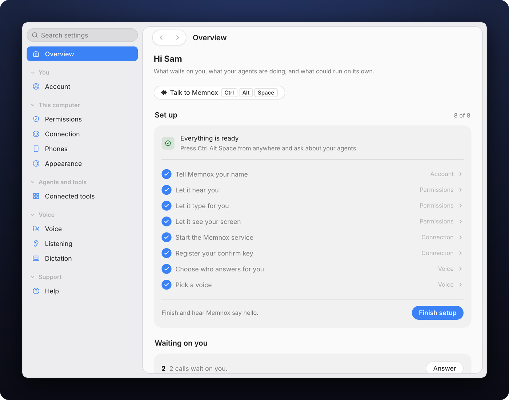

<div align="center">

<picture>
  <source media="(prefers-color-scheme: dark)" srcset="../macos/Support/Logo/memnox-mark-white.png">
  
</picture>

# Memnox for Windows

### The island, the voice and Windows Hello on every yes.

[](#requirements)
[](#requirements)
[](../shared)
[](../LICENSE)

[Install](#install) · [What Windows does differently](#what-windows-does-differently) · [Build](#build-from-source) · [Test](#test) · [Known limits](#known-limits)

<br>

<picture>
  <source media="(prefers-color-scheme: dark)" srcset="../docs/images/tauri-settings-dark.png">
  
</picture>

</div>

---

Memnox for Windows is the Tauri app in [`shared/tauri-core`](../shared), the same one Linux runs.
This folder holds only what Windows does differently: the `memnox-windows` crate in
[`native/`](native), which the shared app depends on only on Windows. Everything else, from the
island to Settings, is written once in [`shared/`](../shared).

## Requirements

- **Windows 10 or 11 on x64.** On an Apple silicon Mac, Parallels or UTM runs the x64 build through
  Windows' own emulation.
- **A TPM and Windows Hello**, where a PIN is enough, so an allow can be signed. A virtual machine's
  virtual TPM works.
- **The microphone switch on for desktop apps**, under Privacy and security, Microphone. Memnox reads
  it before it listens and says so when it is off.
- **WebView2**, which Windows 11 ships with.

No Node and no terminal are needed: the first run finds `memnox` or installs it, fetching its own
Node into `~/.memnox/node` checked against the release's SHASUMS256 when the computer has none.

## Install

Download [memnox.com/download/windows](https://memnox.com/download/windows), the setup `.exe` from
the [latest release](https://github.com/Memnox/memnox-desktop/releases/latest), which also carries the
`.msi` and the `SHA256SUMS` to check either against. The preview is not signed yet, so SmartScreen
says it protected your PC: choose **More info**, then **Run anyway**.

Then open Memnox. The first run installs the runtime, wires the agents it finds, starts the service,
registers the confirm key and installs the voice, and Memnox starts at sign in from then on, which
the tray can turn off.

## What Windows does differently

| | How |
|---|---|
| **The island** | A window at the top centre of the display you choose in Appearance that stays on top, never takes focus (`WS_EX_NOACTIVATE`), never shows in the taskbar or task switcher (`WS_EX_TOOLWINDOW`), and lets every click through except where something is drawn, by following the pointer. It borrows the keyboard only while you rewrite a draft. |
| **The confirm key** | A P-256 key made inside the TPM through the Platform Crypto Provider, used only after Windows Hello says yes over the island's window, naming the call. Its raw signature is converted to DER, the form the runtime checks. |
| **The daemon** | The runtime's per user named pipe, `\\.\pipe\memnox-<account>-<hash of home>`, named exactly as `memnox-runtime` names it. |
| **The keys** | Ctrl Alt Space to talk, Ctrl with left Alt held to say a rule, and right Alt held to dictate, seen through a low level keyboard hook that only looks and passes every key on. On a layout where right Alt is AltGr, right Ctrl dictates instead. |
| **Typing for you** | `SendInput` as Unicode keystrokes, which any app takes whatever the layout, with the focused field read through UI Automation so a password field is never typed into. |
| **Bringing a session forward** | WezTerm through `wezterm cli`, kitty through its remote control, Windows Terminal through `wt` for a new tab, and VS Code, Cursor and Windsurf through their own command line. New tabs run in PowerShell 7 where it is installed. |
| **Glass** | Windows 11's acrylic backdrop with its rounded corners and shadow under the tray panel; a near solid wash on Windows 10. |
| **The tray** | A left click opens Memnox's own panel above the icon, a right click the same rows as a menu. |
| **Coming back** | The lock screen is read from the input desktop, so Catch me up knows when you left and came back. |
| **Keeping awake** | `SetThreadExecutionState` while on power with a phone paired, so the phone can reach the computer from anywhere. |
| **The installer** | NSIS and MSI from [`release-app.yml`](../.github/workflows/release-app.yml), signed with Azure Trusted Signing once its secrets are set. |

## Build from source

You need the Rust MSVC toolchain with Visual Studio's C++ build tools, Node 22, pnpm 9.15.4, Git for
Windows, and a [memnox-runtime](https://github.com/Memnox/memnox-runtime) checkout beside this repo or named
by `MEMNOX_RUNTIME`. From Git Bash:

```sh
cd shared/tauri-core
pnpm wire                 # builds memnox-runtime's core and copies its wire into .runtime
pnpm install
pnpm typecheck && pnpm test
cargo test --workspace    # from the repo root
pnpm tauri dev
```

A debug build never adds itself to the startup apps. `pnpm tauri build --bundles nsis,msi` makes
unsigned installers in `target/release/bundle`.

<details>
<summary><b>Signing a release</b></summary>

[`release-app.yml`](../.github/workflows/release-app.yml) signs every binary and installer through
`trusted-signing-cli` once its secrets are set, and publishes the installers unsigned with a warning
in the run until then. The secrets are `AZURE_CLIENT_ID`, `AZURE_CLIENT_SECRET`, `AZURE_TENANT_ID`, `AZURE_SIGNING_ENDPOINT`,
`AZURE_SIGNING_ACCOUNT` and `AZURE_SIGNING_PROFILE`.

</details>

## Test

CI typechecks, tests and builds the app on `windows-latest` for every pull request. To try it on a
real machine, follow the Windows steps in [TESTING.md](../TESTING.md#windows): install from a
workflow run, answer a held call, and check the signature with `memnox explain <id>`.

## Known limits

- **The TPM key does not demand Windows Hello itself.** A process of the same user that calls NCrypt
  directly could sign without it, so a paired phone stays the stronger place to say yes.
- **The pipe's owner is not checked.** The app opens the runtime's pipe by its per user name, where
  on Linux it refuses a socket that belongs to another user.
- **Windows Terminal cannot switch to a tab**, since `wt` focuses a tab only by an index it never
  lists, so Memnox opens a new one or says it cannot.
- **A teammate's proposal answered by voice** asks for Windows Hello twice, where the Mac asks once.
- **Not proven on hardware yet.** Windows Hello over the TPM key, the named pipe, the keyboard hook,
  typing and the first run's install have been compiled and unit tested, and
  [TESTING.md](../TESTING.md#what-none-of-this-has-proven-yet) lists what a first real run should check.
